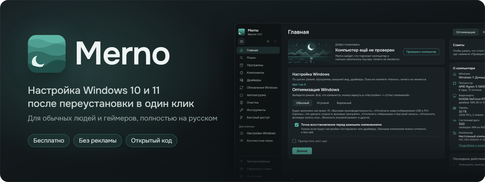
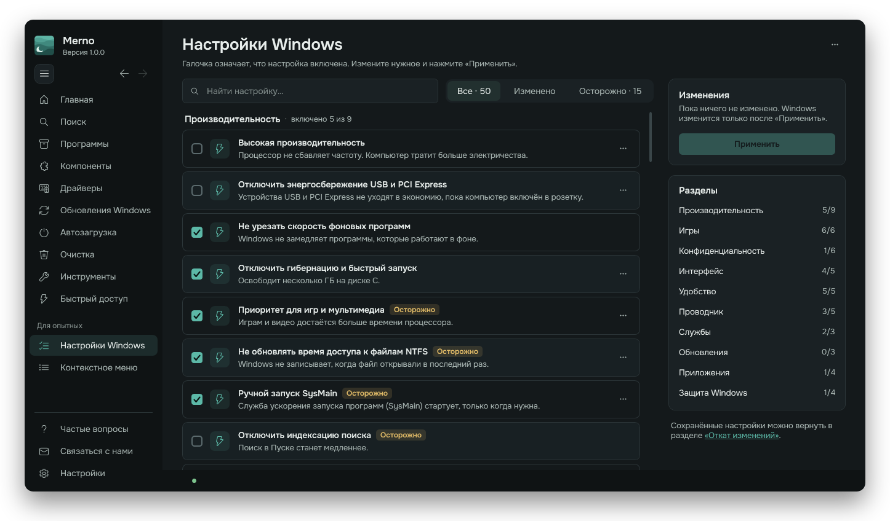
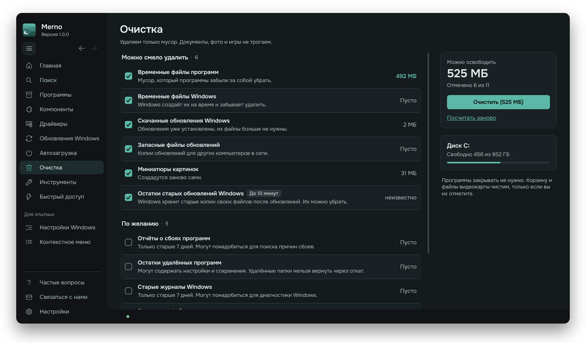

<p align="center">
  
</p>

<p align="center">
  
  <a href="LICENSE.txt"></a>
</p>

Бесплатная программа для настройки Windows 10 и 11 после переустановки в один клик. Для обычных людей и геймеров, полностью на русском.

## Скачать

**[Последний выпуск](https://github.com/Lowomeister/Merno/releases/latest)**: `Merno-Setup.exe` — установщик с автообновлением, `Merno-Portable.zip` — портативная версия, один файл без установки. Файлы `Merno-X.Y.Z.bin` и `version.json` нужны для автообновления, скачивать их не надо.

Нужна Windows 10 или 11 (64-разрядная) и права администратора. Чтобы ставить программы, нужна Windows 10 версии 1809 или новее.

## Что умеет

- **Оптимизация в один клик**: проверка компьютера, режимы «Обычный», «Игровой», «Бережный».
- **Программы и компоненты**: установка, обновление и удаление нужных программ; Visual C++, DirectX, .NET для игр.
- **Драйверы и обновления Windows**: свежий драйвер видеокарты, звук, материнская плата, обновления системы.
- **Автозагрузка и очистка**: меньше программ при включении компьютера, удаление мусора и остатков удалённых программ.
- **Инструменты**: починка Windows, оптимизация дисков, сброс сети, точка восстановления; «Быстрый доступ» к окнам Windows.
- **Для опытных**: «Настройки Windows» (50 настроек, рискованные помечены «Осторожно») и «Контекстное меню».
- **Откат изменений**: сохранённые настройки можно вернуть: «Настройки» → «Откат изменений». Очистку файлов и удаление приложений отменить нельзя.

<p align="center">
  
</p>

<p align="center">
  
</p>

## Принципы

- Ничего не меняется без вашего согласия. Рискованные настройки помечены.
- Никаких активаторов, отключения обновлений Windows и рекламы.
- Работает от администратора, поэтому программа не доверяет файлам, которые может подменить обычный пользователь.

Портативная версия обновляется вручную: скачайте новый архив. Автообновление и автозапуск есть только у установленной Merno (папка `Program Files\Merno`); перед ними Merno проверяет права на папку и файл.

## Сборка

Нужны [.NET 10 SDK](https://dotnet.microsoft.com/download/dotnet/10.0) (нужная версия записана в `global.json`), Python 3.9 или новее (команда `python` должна работать в PATH), [Inno Setup 6](https://jrsoftware.org/isinfo.php) и интернет: `build.ps1` сам скачивает Zig 0.15.2 в папку `obj` и сверяет контрольную сумму.

```
build.bat
```

Готово: `dist\Merno-Setup.exe` (установщик), `dist\Merno-Portable.zip` (портативная) и `dist\Merno-Setup.zip` (комплект для обновления). .NET уже включён в программу.

Чтобы проверить новую сборку у себя, полностью выйдите из Merno через меню значка в трее → «Выход» и запустите свежий `Merno-Setup.exe`. Повторная установка той же версии разрешена. Настройки и копии отката сохраняются.

Проверка перед выпуском: `check.bat` (версии, JSON, сборка, тесты).

Тесты: `dotnet test Merno.Tests\Merno.Tests.csproj` (или откройте `Merno.sln` в Visual Studio). Тесты проверяют чистую логику и не меняют настройки Windows; временные папки создают только рядом со своей сборкой и удаляют за собой.

Проверка вида без изменений в Windows: `Merno.exe --shot <папка> PageHome,PageTweaks` делает снимки страниц в PNG.

## Устройство

| Папка / файл | Что там |
|---|---|
| `Core/` | логика: настройки, очистка, программы, драйверы, откат, обновления |
| `MainWindow.xaml`, `MainWindow.*.cs` | интерфейс, по файлу на раздел |
| `Merno.Tests/` | автоматические проверки безопасности и чистой логики (xUnit) |
| `PageShell.cs`, `FlowColumns.cs` | общая раскладка страниц и списков |
| `Themes/Dark.xaml` | палитра и стили |
| `Assets/` | каталог программ `apps.json`, значки, шрифты, «Что нового» |
| `tools/` | установщик, выпуск на GitHub, проверки, служебные скрипты |
| `docs/` | картинки для README и уведомления о лицензиях .NET |

## Участники (Contributors)

- [Lowomeister](https://github.com/Lowomeister) — разработчик
- [Rub1nchik](https://github.com/Rub1nchik702) — компаньон
- [Claude](https://claude.com/claude-code) (Anthropic) — ИИ-помощник в разработке

## Лицензия

Merno — бесплатный оптимизатор Windows 10 и 11.
Copyright © 2026 Merno contributors.

Merno распространяется по [GNU General Public License версии 3](LICENSE.txt) или, на ваш выбор, любой более поздней версии (GPL-3.0-or-later). Код можно брать, изменять и распространять, в том числе за деньги, но изменённые версии тоже должны оставаться открытыми под этой лицензией. Merno распространяется **без каких-либо гарантий**, подробнее — в тексте лицензии.

> Merno is free software: you can redistribute it and/or modify it under the terms of the GNU General Public License as published by the Free Software Foundation, either version 3 of the License, or (at your option) any later version. Merno is distributed in the hope that it will be useful, but WITHOUT ANY WARRANTY; without even the implied warranty of MERCHANTABILITY or FITNESS FOR A PARTICULAR PURPOSE. See the GNU General Public License for more details.

Название «Merno» и значок Merno в лицензию не входят: свою версию нельзя называть Merno и выдавать за неё. Неизменённые выпуски Merno можно распространять как есть, с названием и значком (например, выложить на сайт загрузок со ссылкой на этот репозиторий).

Сторонние компоненты, шрифт Onest (SIL OFL) и происхождение изображений: [THIRD-PARTY-NOTICES.md](THIRD-PARTY-NOTICES.md). Сообщить об уязвимости: [SECURITY.md](SECURITY.md).

## Что уходит в сеть

Merno проверяет обновления при каждом запуске. Это можно выключить: «Настройки» → «Проверять обновления Merno сам». GitHub при этом видит IP-адрес и номер версии Merno (github.com/Lowomeister/Merno/releases). Файлы обновления скачиваются после действия пользователя.

Если на компьютере видеокарта NVIDIA, на странице «Драйверы» Merno узнаёт у NVIDIA номер свежего драйвера; NVIDIA видит только IP-адрес. Страница «Обновления Windows» при открытии ищет обновления через Центр обновления Windows. Если на компьютере нет winget, Merno скачивает его с GitHub (проект microsoft/winget-cli). winget обращается к своим источникам; установщики и драйверы идут к указанным в карточках поставщикам, включая GitHub и сайты производителей. Ссылку на установщик Spotify Merno берёт из стороннего списка LoaderSpot и запускает установщик, только если он подписан Spotify. Для значков используются Microsoft Store и сервис значков Google: им видны IP-адрес и название программы или адрес сайта.

Раздел «Связаться с нами» сам ничего не отправляет: кнопка «Написать в Telegram» открывает бот поддержки, и человек пишет туда сам. «Скопировать сведения» кладёт в буфер обмена версии Merno и Windows, компьютер одной строкой и последние ошибки; распространённые личные данные (имя пользователя, имя ПК, пути профиля) из них убираются, но автоматическая очистка не гарантирует удаления всех секретов, поэтому проверьте текст перед отправкой. Отчёт о сбое Merno кладёт в свою папку данных и при следующем запуске предлагает скопировать его и написать в Telegram; без согласия человека он никуда не уходит. Telegram видит то, что человек отправил боту, и его аккаунт.

## Подпись кода (Code signing policy)

Сейчас выпуски Merno **не подписаны**: Windows может показать предупреждение SmartScreen, а «Интеллектуальное управление приложениями» в Windows 11 — заблокировать запуск. Мы собираемся подать заявку на бесплатную подпись в [SignPath Foundation](https://signpath.org/). Когда её одобрят, этот раздел обновится.

Подписываться будут только файлы, собранные из этого репозитория в GitHub Actions (`.github/workflows/build.yml`): запускатель, программа, портативная версия и установщик. Каждый выпуск подтверждается вручную.

- Разработка и проверка изменений (committers and reviewers): [Lowomeister](https://github.com/Lowomeister)
- Подтверждение подписи (approvers): [Lowomeister](https://github.com/Lowomeister)

Политика приватности: Merno не передаёт данные в другие сетевые системы, кроме описанного в разделе «Что уходит в сеть» выше и того, что пользователь запускает сам.
